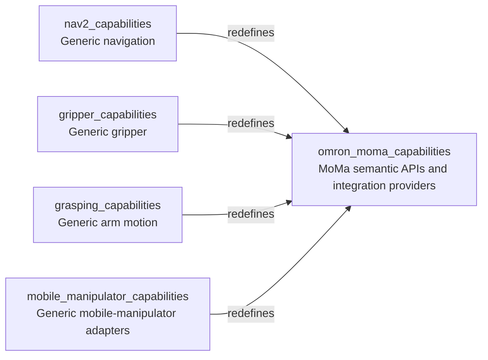

# Omron Mobile Manipulator Capabilities

Omron MoMa specializes the generic navigation, gripper, grasping, and mobile-manipulator capability interfaces with MoMa providers and semantic APIs.

## Purpose



MoMa semantic interfaces redefine the generic interfaces directly. The current capabilities2 loader does not support semantic interfaces redefining other semantic interfaces.

## Launch ownership

- `MoMaNav2LaunchRunner` starts `moma_ros/ld250_tm12x.launch.py`, which owns the LD250 base, TM12X arm, MoveIt, and Nav2 bringup.
- `MoMaGraspingLaunchRunner` starts only the grasping motion-execution nodes with the MoMa motion and workspace configuration; it depends on the MoMa Nav2 launch provider rather than starting another robot stack.
- MoMa gripper command/state providers depend on `gripper_capabilities/GripperLaunchRunner`.
- `MoMaMobileManipulatorLaunchRunner` starts the MoMa task-feasibility coordinator after the robot and grasping providers are ready.

Do not launch another whole-platform bringup alongside the MoMa Nav2 provider. In particular, do not combine this provider with `grasping_omron_moma/ld250_tm12x_soft_two_fingers.launch.py`, which also owns robot bringup.

## Plan Groups

| Group | Plans | Purpose |
| --- | --- | --- |
| Navigation | `moma_nav2_1.xml`, `moma_nav2_2.xml` | MoMa waypoint navigation through its semantic interface. |
| Grasping | `moma_grasp_1.xml` to `moma_grasp_4.xml` | Cartesian, joint-space, and named-pose arm motion. |
| Gripper | `moma_gripper_1.xml`, `moma_gripper_2.xml` | Gripper command examples using the MoMa gripper provider. |
| Mobile manipulator | `moma_mobile_manipulator_1.xml` to `moma_mobile_manipulator_4.xml` | Feasibility checks, base-pose search, and execution with explicit validation/approval inputs. |
| Generative | `moma_generative_1.xml` to `moma_generative_5.xml` | Prompt-generated navigation/manipulation plan examples. |

All pose, joint, and waypoint values are illustrative and unvalidated for a physical robot or site. Mobile-manipulator execution requires a validated task pose and an explicitly approved base pose. Generated plans are automatically queued without a review pause; do not use them on hardware without an independent approval gate.

## Build

```bash
cd ~/colcon_ws
colcon build --packages-up-to omron_moma_capabilities --symlink-install
```

## Runtime

The system wrapper starts Fabric and Capabilities2. Providers start their declared dependencies on demand.

```bash
source install/setup.bash
ros2 launch omron_moma_capabilities system.launch.py filename:=moma_nav2_1.xml
```

Use the same wrapper with another plan filename. The MoMa Nav2 provider uses `moma_ros` launch defaults for robot IP and simulation mode; verify those settings and all robot-specific configuration before any physical run. No robot launch or motion is performed by building this package.

For more detail, see [docs/standalone_testing.md](./docs/standalone_testing.md).